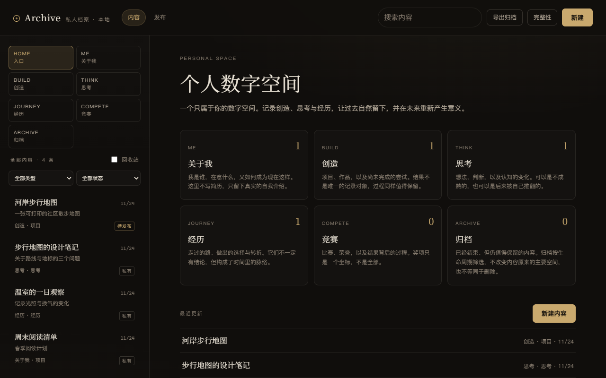
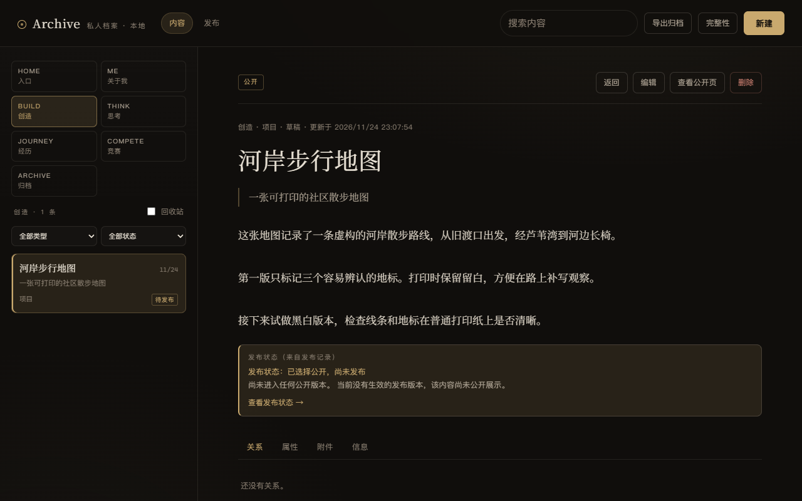
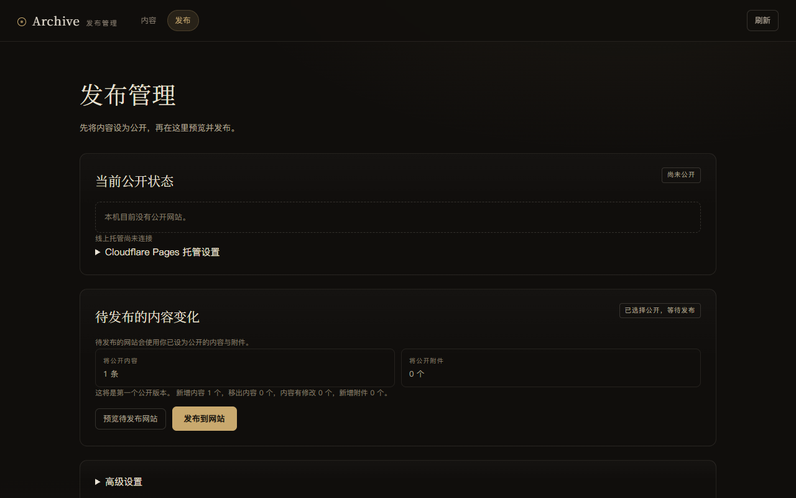

# 个人数字空间 · Personal Digital Space

[](https://github.com/sxingyao808-glitch/personal-digital-space/actions/workflows/windows-ci.yml?query=branch%3Amain)

一个本地优先的个人档案，用来记录项目、经历和思考，建立它们之间的联系，并把选中的内容发布成静态网站。

把正在推进的项目、过程笔记和事后回顾保存在自己的设备上。记录默认私有，准备分享时可以先预览公开范围，再确认发布。

A local-first personal digital space for organizing, connecting, preserving, and selectively publishing personal knowledge, projects, experiences, and ideas.

Keep an editable archive on your own device, link related records, and preview what you want to share before publishing a curated static site. The application UI is currently in Simplified Chinese.

## Core features

- Organize projects, thoughts, and experiences by space and lifecycle. Search them, link related items, and add attributes with provenance.
- Attach files, check their integrity, and recover archived or soft-deleted content.
- Review an explicit public selection and its attachments before publishing a static snapshot. The local site works without a hosting account. Cloudflare Pages integration requires a separate configuration and explicit online publication.
- Export selected records or back up the archive and restore it to a separate directory. Back up the publication registry separately if you need to preserve local publication history and withdrawal state.

## Screenshots

The V1.0 browser interface running with fictional records.



<details>
<summary>Reading a record and reviewing publication</summary>





</details>

## Core workflow

1. **Capture privately.** Add a project, experience, or thought, along with any supporting files.
2. **Organize and connect.** Choose a space and lifecycle, then link related records as the archive grows.
3. **Review and publish.** Mark the intended records and attachments public, review the pending changes in **发布** (Publish), and preview the site before confirming. Visitors see the activated static snapshot. Cloudflare Pages deployment requires a configured target and explicit online confirmation. [Publication boundary](docs/architecture.md#publication-boundary)

## Quick start

Use a browser, a writable local data directory, and a [CPython 3.14](https://www.python.org/downloads/release/python-31410/) runtime with SQLite 3.51.3 or newer. Source validation uses Windows x64 with CPython 3.14.10 and SQLite 3.54.1. The Python service can run on its own.

From the checkout root in Windows PowerShell, create a virtual environment and install the Python dependencies.

```powershell
python -c "import sqlite3, sys; print(sys.version.split()[0], sqlite3.sqlite_version)"
python -m venv .venv
.\.venv\Scripts\python.exe -m pip install -r requirements.txt
```

To try the interface with fictional records and attachments, use a fresh demo directory.

```powershell
.\.venv\Scripts\python.exe run_app.py --data-dir ./archive_data/demo --init-fixture --no-open
```

Open the owner login URL printed at startup and keep it private. The server listens on loopback and selects an available port. The demo fixture leaves the public site inactive. To start your own archive, use a separate directory and omit the fixture flag.

```powershell
.\.venv\Scripts\python.exe run_app.py --data-dir ./archive_data --no-open
```

## Architecture

The local service uses Python and Flask to serve the owner interface on loopback. SQLite stores archive records and the local filesystem holds attachments. The Electron shell starts and manages the same backend. Anonymous visitors read an activated static snapshot. See [Architecture](docs/architecture.md) and [Data model](docs/data-model.md) for the boundaries, schema, and migrations.

## Privacy, security, and data protection

- The source launcher uses `./archive_data` relative to the working directory by default. The desktop shell defaults to `%LOCALAPPDATA%\PersonalDigitalSpaceOSS\data`. The archive keeps `archive.db` and attachments in the data directory.
- The owner session uses a signed, HttpOnly, SameSite cookie. State-changing API requests require a CSRF token. Keep the data directory, owner login URL, backups, and hosting configuration private.
- Only the reviewed static snapshot is served to anonymous visitors. The private archive, attachment store, and publication registry remain local.

### Backup and recovery

Stop the server before running these commands. Use new output names and a fresh restore target on a local filesystem that supports hard links.

```powershell
.\.venv\Scripts\python.exe run_app.py --data-dir ./archive_data --backup
.\.venv\Scripts\python.exe run_app.py --data-dir ./archive_data --registry-backup
.\.venv\Scripts\python.exe run_app.py --restore "<archive-backup.zip>" --target ./archive_data/restored
.\.venv\Scripts\python.exe run_app.py --data-dir ./archive_data/restored --restore-registry "<registry-backup.zip>"
```

The first two commands report the generated paths. Keep these packages private. After restoring, review the result and publication state before restarting or publishing.

## Support and known limitations

- **V1.0 is a source release.** Source use was validated on Windows x64. Independent Windows installer acceptance remains pending, including installation, upgrade, uninstall, and multi-account isolation. [Release notes](CHANGELOG.md)
- **Public pages are static snapshots.** Edits and visibility changes in the private archive do not update an already published snapshot. Use the publication controls to update or withdraw it. Previously downloaded copies and third-party hosting or CDN caches may remain accessible after withdrawal.

## Development and testing

<details>
<summary>Electron source launch and local Windows build</summary>

Use Windows x64, PowerShell 5.1 or newer, Node.js 24 and npm. Install the Python requirements above and run `npm.cmd ci --prefix desktop`. To launch the Electron shell from source:

```powershell
$env:ARCHIVE_PYTHON = (Resolve-Path ./.venv/Scripts/python.exe).Path
npm.cmd --prefix desktop start
```

An explicit `ARCHIVE_DATA_DIR` override must point to an existing absolute directory.

For a Windows x64 NSIS build, prepare an isolated, pip-enabled runtime using the CPython and SQLite archives and digests in [desktop/runtime-lock.json](desktop/runtime-lock.json). Replace the runtime's SQLite DLL with the verified one and set `PDS_BUILD_PYTHON` to that runtime's `python.exe`. Then run:

```powershell
npm.cmd --prefix desktop run build:installer
```

The build checks the CPython version and SQLite source ID and verifies the packaged DLL hash. The unsigned installer is written under `desktop/release/` for local development.

</details>

```powershell
.\.venv\Scripts\python.exe -X utf8 -m unittest discover -s tests -v
```

The standard suite uses temporary synthetic archives and mock hosting. A live Cloudflare test is opt-in and some filesystem cases require Windows symbolic-link permission. Keep live credentials out of ordinary test runs.

## License and contributing

Personal Digital Space is available under the [MIT License](LICENSE). You may use, modify, distribute, and sell the software, including for commercial use. Include the copyright notice and license text when distributing copies or substantial portions of the software. See [third-party dependencies](docs/third-party.md) for their separate terms.

Copyright (c) 2026 sxingyao808-glitch

The public repository began with a clean, independent source commit to keep private records, internal material, and private development history out of the public project.

Use fictional data when sharing examples or diagnostics. See [Contributing](CONTRIBUTING.md) and [Security](SECURITY.md).
